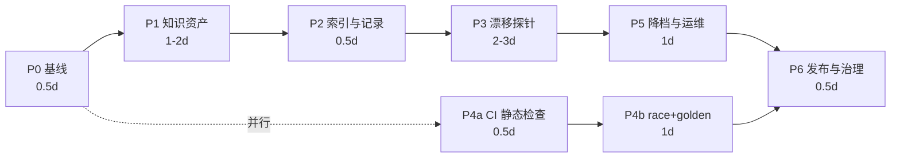

# 分步执行计划（接管维护）

> 配套文档：`MAINTAINING.md`（策略与理由）。本文件只讲**按什么顺序做、每步怎么验收**。
> 时间估算按**一个人、每天 2-3 小时**计。

## 总览



**关键路径**：P0 → P1 → P2 → P3 → P5 → P6（约 5-7 天有效工时）。
**可并行**：P4a 随时可插（与 P1 并行最省时）。

**顺序不是随便排的**：
- P3 的形状断言需要"预期长什么样"——那个"预期"就来自 P1 的协议档案与 P2 的索引。先写探针会退化成"把当前行为拍成快照"，把 bug 一起固化。
- P0 必须最先：没有 green commit，后面所有改动都没有退路。

---

## P0 基线固化（0.5 天）

> **状态：已完成（2026-10-21）**，tag `v1.13.0-maintain-base`。执行记录见本节末尾。

| # | 任务 | 具体做法 | 验收 |
|---|---|---|---|
| P0-1 | 装 Go | 装 **1.22.5**（对齐 `go.mod`）。或临时用 Docker：`docker run --rm -v %cd%:/w -w /w golang:1.23 go build ./...` | `go version` 有输出 |
| P0-2 | 跑通基线 | `go build ./...` → `go vet ./...` → `go test ./...`。**注意**：`TestAppJSTopLevelSmoke` 需要 node，没 node 会 skip/失败——先确认是 skip 而非 fail | 三条命令全绿 |
| P0-3 | 记录 green commit | `git rev-parse --short HEAD` 记进维护笔记；`git tag v1.13.0-maintain-base` | `git tag -l "*maintain*"` 有输出 |
| P0-4 | 构建脚本化 | 新建 `Makefile`（`build`/`test`/`vet`/`all`/`clean`）+ `scripts/build.ps1` + `scripts/build.sh`，把 README「方式三」4 条 `go build` 收进去 | `make all` 一条命令产出 4 个二进制 |
| P0-5 | 解除文档禁令 | `.gitignore`：删掉 `docs/` 行，把 `*.md` + `!README.md` 改为 `!docs/**/*.md`（**必须先删 `docs/`，git 不会进入被整体忽略的目录**） | `mkdir docs && echo x > docs/a.md && git status` 能看到该文件 |

**回退**：本阶段只加文件与 tag，不碰源码。任何异常 `git checkout .` 即可。

**产出**：可复现构建环境、green commit、tag、构建脚本、可提交的 docs 目录。

### P0 执行记录（实际发生的事）

环境与预期不同：**这台机器既没有 Go 也没有 Docker**，改用便携版 Go（不改系统 PATH）：

```
E:\Documents\下载\新建文件夹 (11)\tools\go\bin\go.exe   # go1.22.5 windows/amd64
```

`scripts/build.ps1` 会自动发现它（GBIN → PATH → `..\tools\go` → `.tools\go`），换机器时无需改脚本。

基线结果：`go build ./...`、`go vet ./...`、`go test ./...` **全绿**（19 个包全部 ok，首次约 3 分钟，含依赖下载）。

**计划外的两个发现（都已修，并已改变后续步骤）**：

1. **CRLF 陷阱（重要）**：开发机 `core.autocrlf=true`，仓库无 `.gitattributes` → 工作区全是 CRLF →
   `gofmt -l` 把 **182 个 .go 全部**判为"未格式化"。这不是格式问题，是行尾问题。
   - 处理：`gofmt` 门禁做 **CRLF 容错**（对存疑文件先归一 LF 再判，只有真格式问题才失败）；
   - 根治：新增 `.gitattributes` 约定源码 LF / PowerShell CRLF；
   - 验证：全新 clone 后 `gofmt -l` = **0**，证明原报告全是行尾差异；
   - 附注：Dockerfile 里那句 `sed -i 's/\r$//'` 就是同一个坑的历史遗迹，行尾统一后未来可以删掉。
2. **18 个文件真实格式漂移**：作者手工对齐结构体字段（多余空格），gofmt 要求单空格。
   已单独提交 `chore(gofmt)` 归一（`git diff --ignore-all-space` 为空，纯空白，无语义改动）。
   不先归一，gofmt 门禁会对**所有**提交恒失败。

另外两个踩坑记录，避免重复花时间：

- **`scripts/build.ps1` 必须保持 UTF-8 with BOM**。Windows PowerShell 5.1 会把无 BOM 的 UTF-8 按 GBK 解析，中文字符串直接报"字符串缺少终止符"。每次编辑后确认前三字节是 `EF BB BF`。
- **PS 函数不能直接接 `-o` 这类短参数**：`Invoke-Go build -o x` 会被当成函数参数名解析（与 `-OutVariable/-OutBuffer` 二义）。统一用数组整体传参 `Invoke-Go @('build','-o',$out,$pkg)`。

实际提交（3 个，均为纯基建，未改任何业务逻辑）：

```
a702c95 chore(gofmt): 归一 18 个文件的空白对齐，使 gofmt 门禁可用
2509654 chore(p0): 接管维护基线 — 构建脚本、文档解禁、维护方案
53a4e99 chore(repo): 新增 .gitattributes 统一行尾契约
tag: v1.13.0-maintain-base
```

**验收命令**（本机一条命令复核基线）：

```powershell
.\scripts\build.ps1 check     # gofmt + vet + test，一条命令确认基线仍绿
.\scripts\build.ps1 version   # 1.13.0-panel —— 发版时须与 tag 对齐
```

---

## P1 知识资产（1-2 天，**最高优先**）

> **状态：已核查 → 改为「计划 B：重建」**（2026-10-21）
>
> 核查结论：**外部逆向文档从未进入任何仓库，不可找回**。证据（均可复现）：
> `git log --all --diff-filter=A --name-only` → 除 README 与 `internal/prompt/defaultprompt.md` 无任何 `.md`；
> `git log --all -- 'docs/*'` → 空；本地无 `data/`；同级副本无 `data/`；磁盘搜索无命中。
> 原因：`.gitignore` 自建仓起就排除 `docs/` 与「除 README 外的 `*.md`」，这些文档只在原作者本机。
>
> 所以 **P1-2「搬入已有文档」不存在了**，改为从代码反向重建。详细清单与流程已落库：
> `docs/protocol/README.md`（来源分级 + 13 类待重建材料 + 流程）、`docs/protocol/UNVERIFIED.md`（14 条待验证断言）。
>
> **连带影响：P3 与 P1 的关系从「先后」变成「互相校准」**——没有原始文档，探针就是唯一的 ground truth。
> P1 出草稿（B 级），P3 出证据（A 级）。执行顺序建议：P1 骨架 → P3 探针 → 回填档案。

| # | 任务 | 具体做法 | 验收 |
|---|---|---|---|
| ~~P1-2~~ | ~~搬入已有文档~~ | **已撤销**：源文档不可得，改为 `docs/protocol/README.md` §3 的重建流程 | — |
| P1-1 | 建目录骨架 | `docs/protocol/` + `README.md`（核查结论/分级/待重建清单）+ `TEMPLATE.md` + `UNVERIFIED.md` | ✅ 已完成 |
| P1-2b | 静态抽取草稿 | 按 `internal/upstream/*.go` 逐文件抽「端点 / 必需头 / 请求体 / 判据 / 错误码 / 失效表现」，全部标 **B 级** | 13 份档案清单至少完成 5 份（优先 `headers.md`、`desktop-events.md`、`growth-report.md`、`model-catalog.md`、`thinking-effort.md`） |
| P1-3 | 密钥扫描脚本 | `scripts/check_docs_secrets.ps1`（或 `.py`），扫 `docs/` 与 `*.md`，命中 `accessToken`/`refreshToken`/`Bearer`/手机号即 exit 1 | 故意塞一行假 token → 脚本报错 |
| P1-4 | 指针 → 锚点 | 约 20 处引用外部文档的注释：**保留原指针**（历史证据），同段补一行 `// 原始文档不可得，结论见 docs/protocol/<档案>.md#<锚点>` | 随机抽 5 处，都能跳到仓库内可读的档案 |
| P1-5 | 校准回填 | P3 探针跑通后，把 B 级标注替换为 `实测 <日期> · doctor:<探针>`（A 级）；被推翻的标 🔴 并记"失效于 <日期>" | `UNVERIFIED.md` 里 ✅ 数量 ≥ 6 |

**为什么要做这一步**（一句话给未来的自己）：代码里 `sse.ts:91-123` 这种引用，指向的是**永久不会出现**的文件。不重建，这些注释就是无法验证的断言；上游一改，你只能从零逆向——而这正是作者停更的原因之一。

**回退**：文档独立目录，删掉即可，不影响代码。

---

## P2 定位索引与变更记录（0.5 天）

| # | 任务 | 具体做法 | 验收 |
|---|---|---|---|
| P2-1 | `docs/TRIAGE.md` | 用 `MAINTAINING.md` §2.4 那 12 行草稿做骨架，每行补"看哪个符号 / 哪行日志" | 拿一个真实症状，能在 3 分钟内定位到文件，**不读全码** |
| P2-2 | `CHANGELOG.md` | Keep a Changelog 格式；每条写"上游变了什么 / 依据哪份档案 / 影响 L0-L3" | 补上近 3 个 tag 的条目 |
| P2-3 | 断言表去行号 | README「关键断言 ↔ 代码出处」31 条，`file.go:123` 改为 `file.go · 符号名` | 全文无 `\.go:\d+` |

**P2-3 的理由**：行号每次改动就失效，31 条错行比没有更糟。

---

## P3 漂移探针 `doctor`（2-3 天，**核心交付**）

> **状态：v1 已交付（2026-10-22）** —— `internal/upstream/probe.go` + `cmd/doctor` + 11 个契约测试，
> `go build` / `go vet` / `go test` 全绿。剩余：真实账号校准（P1-5）。**P3-3b/3c/3d 全部完成（2026-10-22）**：面板 `GET /panel/api/upstream_health` + 每 6h 自动巡检 + 账号池健康卡片。
>
> 跑法（只读、不花积分、不动账号状态）：
>
> ```powershell
> go run ./cmd/doctor -config config.json                    # 竖排报告
> go run ./cmd/doctor -config config.json -json              # 机读
> go run ./cmd/doctor -account <uid> -out none                 # 单号、不落盘
> go run ./cmd/doctor -chat                                  # 追加对话探针（花积分）
> ```
>
> 退出码 0 全绿 / 1 有黄 / 2 有红；默认落盘 `data/upstream_health.json`。
>
> **执行期两个实测发现**：
> 1. `models` 探针走 `/v3/config`，**无效 token 也能拿到 19 个模型**——所以它判绿只说明"目录形状没变"，
>    不能当"账号可用"；账号可用性看 `account` 探针。已写进 `probeModels` 注释。
> 2. 上游 401/403 返回整页 APISIX WAF HTML，原样进报告会打乱布局——已在 `truncateForProbe` 里
>    剥标签 + 压单行 + 截断 120 字符。
>
> 判级与豁免口径（写死在测试里，改口径先改测试）：业务 `code != 0` → 红；5xx → 红；
> 个人号 403 → 红；**企业版 403 / 400 code 10001 → 绿（预期，避免每天假告警）**；
> 老任务码交集 < 60% → 黄；任务列表空 → 黄。

目标：把"上游偷偷改协议 → 用户报错 → 现场逆向"反转成"探针告警 → 按需修"。

### P3-1 探针定义（`internal/upstream/probe.go`）

每个探针 = `{名称, 端点, 只读, 期望形状}`，形状校验用"字段存在性 + 集合交集"，不用深度相等（避免上游加字段就报警）。

| 探针 | 端点 | 花费 | 红（坏） | 黄（漂移） |
|---|---|---|---|---|
| refresh | `plugin/auth/token/refresh` | 免费 | 非 2xx / 无新 token | token 字段改名 |
| models | `console/enterprises/personal/models` | 免费 | 空列表 | 已知模型命中率 < 80% |
| balance | `billing/meter/get-user-resource` | 免费 | 非 2xx | 结构字段缺失 |
| streak | `activity/growth/streak` | 免费 | 非 2xx | `days` 字段缺失 |
| tasks | `activity/growth/tasks` | 免费 | 非 2xx | 任务码交集 < 80% |
| compensation | `billing/meter/compensation-status` | 免费 | 非 2xx | `active` 字段缺失 |
| buddy | `activity/growth/buddy/info` | 免费 | 非 2xx | 结构变化 |
| account | `console/account` | 免费 | 非 2xx | — |
| search | `/agenttool/v1/search` | 免费 | 非 2xx | 结果块类型变化 |
| chat（可选，默认关） | `chat/completions` `max_tokens=8` | **花积分** | 无首帧 | `finish_reason` 异常 |

**三条硬规则（写进代码注释与测试）**：
1. **绝不写**：不签到 / 不领奖 / 不上报 / 不建长会话。探针必须任何人随时可跑。
2. **形状优先于状态码**：上游改字段名照样返 200，这是最阴的变更。
3. **企业号作对照**：企业号对 growth 端点应返回 403 —— 403 就是"绿"，这是免费的契约校验。

### P3-2 命令行（`cmd/doctor/main.go`）

```powershell
go run ./cmd/doctor -config config.json            # 全账号矩阵，人类可读表
go run ./cmd/doctor -config config.json -json      # 机读
go run ./cmd/doctor -account <uid> -json           # 单号
go run ./cmd/doctor -offline                       # 只校验本地配置/文件，不打上游
```

退出码：`0` 全绿 / `1` 有黄 / `2` 有红（方便宿主 cron 与告警接入）。

### P3-3 落盘 + 面板

| # | 任务 | 做法 | 验收 |
|---|---|---|---|
| P3-3a | 输出文件 | 写 `data/upstream_health.json`（同 `output_probes.json` 的位置约定） | 文件生成，含 `generated_at` 与逐账号逐探针状态 |
| P3-3b | 面板只读透传 | 照 `ProbeFile` + `GET /panel/api/model_probes` 的模式：新增 `HealthFile` 字段 + `GET /panel/api/upstream_health` | ✅ 已完成（`internal/panel/health.go` + 4 个测试；端到端冒烟：接口 200 / 无 key 401 / 报告中转正确） |
| P3-3c | 前端卡片 | 账号池顶部一行「上游健康 绿X/黄X/红X · N 分钟前」+ 点行展开逐探针明细（含耗时/详情/漂移项） | ✅ 已完成（`index.html` + `app.js` + 3 个 node 前端测试；端到端冒烟：卡片在 HTML 内、接口 200） |
| P3-3d | 定时跑 | 复用 scheduler 同构 ticker（`StartHealthCheck`/`SetHealthCheckInterval`/`HealthCheckHook`），**不碰 `taskKind` 枚举**；配置 `schedule.health_check_enabled` / `health_check_minutes`（缺省 6h），面板保存热生效 | ✅ 已完成 |

### P3-4 测试

| # | 任务 | 做法 | 验收 |
|---|---|---|---|
| P3-4a | 三态测试 | `probe_test.go` 用 `httptest` 造假上游，断言红/黄/绿判定 | `go test ./internal/upstream -run Probe -v` 通过 |
| P3-4b | 漂移演练 | 假上游**改一个字段名**，断言由绿转黄（不是红） | 演示一次，截日志 |

**P3 DoD**：一条命令出全账号矩阵；改字段名能判黄；全程零写操作（用上游日志或抓包自证）；`-race` 下无告警。

---

## P4 测试与 CI 加固（1-2 天，可与 P1 并行）

> **状态：已完成（2026-10-22）**。本地 `check` 与 CI 同口径：
> `gofmt → vet → test → docs-secrets → protocol-refs`（`scripts/build.ps1 check` / `make ci`）。
>
> **阻塞**：test / gofmt / vet / docs-secrets / protocol-refs / `staticcheck -checks SA*`
> **非阻塞（观测）**：全量 staticcheck（剩 16 条 unused 与风格）、`govulncheck`、`-race` 独立 job
>
> 两个必须知道的结论：
> 1. **govulncheck 实测 43 条标准库漏洞** —— 根因是 `go.mod` 钉的 Go 1.22.5 偏旧
>    （x509 / net/http 等已有修复的 CVE）。解法是**升工具链**，不是改代码；已转独立待办。
> 2. **`-race` 首版设成非阻塞** —— 维护者本机无 gcc，无法预先验证接入时是否已绿。
>    观察 1-2 次 CI 全绿后再去掉 `continue-on-error`。没验证过的门禁不能设成阻塞。

| # | 任务 | 做法 | 验收 |
|---|---|---|---|
| P4a-1 | 静态检查 | CI 加 `gofmt` / `go vet` / `staticcheck -checks 'SA*'`（均阻塞）+ 全量 staticcheck（观测） | ✅ 已完成。接入时把 4 条 SA 全处理：2 条真修（空分支、同表达式测试）、1 条加 lint directive（chatPaths 单路径说明）、1 处让 `needsRegion` 进报错 |
| P4a-2 | 漏洞扫描 | `govulncheck@v1.1.4`（非阻塞） | ✅ 已接入。**实测 43 条标准库漏洞** → 转独立任务：升 Go 工具链 |
| P4a-3 | 文档密钥扫描 | 把密钥扫描脚本挂进 CI（阻塞） | ✅ 已完成，顺带挂上 `protocol-refs` 锚点检查 |
| P4b-1 | 竞态 | `go test -race ./internal/pool/... ./internal/scheduler/...`（独立 job，不拖慢 test job） | ✅ 已接入（**首版非阻塞**，见上） |
| P4b-2 | golden 扩容 | `desktop.go` / `tasks.go` 的请求体做成快照测试 | ⬜ 未做（成本高、收益偏 L3） |
| P4b-3 | 依赖 | 开 Dependabot | ⬜ 未做（GitHub 仓库设置里开，非代码改动） |

**注意**：不要动现有发布纪律（`appVersion` ↔ tag 一致性断言、五平台矩阵）——那块是作者留下的好东西。

---

## P5 降档与运维（1 天）

| # | 任务 | 做法 | 验收 |
|---|---|---|---|
| P5-1 | 降档预设 | `data/presets/{normal,throttle,survival}.json`，只放**差异键**（并发、排程时点、UA 版本）。切换 = 覆盖合并 `config.json` 后用面板热生效 | 切到 throttle 后 `/status` 显示在途上限已降 |
| P5-2 | `docs/RUNBOOK.md` | 写清：降档梯子（并发↓ → 对齐 UA/设备头 → 单号轮换 → 只留 L0）、「暂停选号」正确用法（**不是禁用**）、备份/恢复、账号复活 | 照文档能独立完成一次降档与回滚 |
| P5-3 | 备份演练 | 备份 `auths/` + `data/state.json` + `config.json`，然后**真的恢复一次**（新目录起实例） | 恢复后 `/status` 账号数与积分与备份前一致 |
| P5-4 | 退出判据入 README | 4 条量化条件（L0 成功率 <50%、全号无法对话、明确"非官方客户端"拒绝且改头无效、账号存活 <72h）+ "满足两条且持续 7 天" | README 有该节 |

**P5-3 别省**：没演练过的备份等于没有备份。这一步能暴露 `auths/` 权限、`state.json` 版本字段等真问题。

---

## P6 发布与治理（0.5 天 + 持续）

| # | 任务 | 做法 | 验收 |
|---|---|---|---|
| P6-1 | `CONTRIBUTING.md` | 抄 `MAINTAINING.md` §9：接受清单 / 拒绝清单（批量开号、多租户售卖、卡密加壳、共享池、风控对抗升级） | 文件在库 |
| P6-2 | Release 流程 | 现有 CI 已断言 `appVersion` == tag；补 release note 模板（变更 / 依据档案 / 影响级别 / 降档建议） | 走通一次 patch release |
| P6-3 | 维护状态披露 | README 顶部加：「由个人接管，**只修不加**；L3 逆向功能可能长期不修」 | 声明诚实、不承诺 SLA |

---

## 时间表（建议）

| 周 | 内容 |
|---|---|
| 第 1 周 | P0（0.5d）+ P1（1.5d）+ P4a（0.5d 并行） |
| 第 2 周 | P2（0.5d）+ P3（2.5d） |
| 第 3 周 | P4b（1d）+ P5（1d）+ P6（0.5d） |
| 之后 | 每周 30 min 跑 doctor；每月一次依赖+全量测试+CHANGELOG；每季决定"继续/冻结/归档" |

## 最小可执行路径（只想自用，1 天版）

只做 3 件事，其余全部延后：

1. **P0-1 + P0-2 + P0-3**（装 Go、全绿、打 tag）— 40 min
2. **P1-1 + P1-2 + P1-3**（建目录、脱敏搬文档、扫密钥）— 2 h
3. **P3-1 + P3-2**（只读探针 + CLI，暂不做面板、不做定时）— 4 h

后两项分别解决"半年后还能不能修"和"你是追着修还是被告知"。

## 计划自身的验收（怎么知道这套东西有用）

跑一个月后回头对这四个指标，任一条不达标就说明计划需要改：

| 指标 | 目标 |
|---|---|
| 上游变更的**发现时延** | 从"用户报错"降到 **< 24h**（doctor 每日跑） |
| 单次修复**定位时间** | < 15 min（TRIAGE 命中） |
| 修复**改动面** | 单文件 + golden 测试（改不动就说明该重构） |
| L3 功能**腐烂率** | 每季度显式"承认放弃"或修好，不允许无限期半坏 |

## 已知风险

| 风险 | 影响 | 缓解 |
|---|---|---|
| 装 Go 后测试有既有失败 | P0 卡住 | 先判断是环境（node/python）还是真失败；真失败则记录并 fix-or-skip，**不要带着红基线往下走** |
| 逆向文档拿不到 / 已丢失 | P1 无法完成 | 退化为：把注释里的引用改成"原档不可得 + 实测日期 + 结论"，先保住结论 |
| P3 形状断言把 bug 固化 | 探针假绿 | 断言只校验"字段存在 + 集合交集"，不比对具体值；用 P1 档案校准而非当前响应 |
| 上游彻底封死 | P5/P6 白做 | 这正是 P5-4 退出判据存在的意义：**知道什么时候该停**比多修一个功能重要 |
| 面板前端改动引入回归 | 面板不可用 | P3-3c 前端延后；先 API + 日志，前端单独一个 PR |
